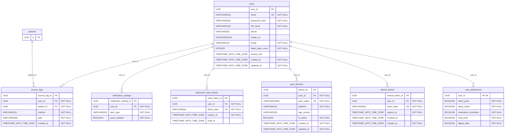
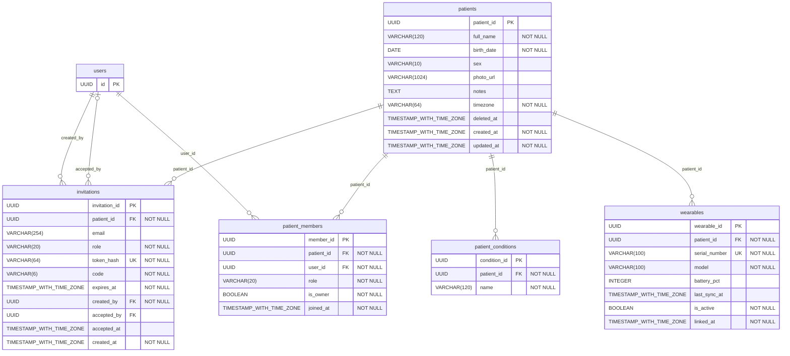
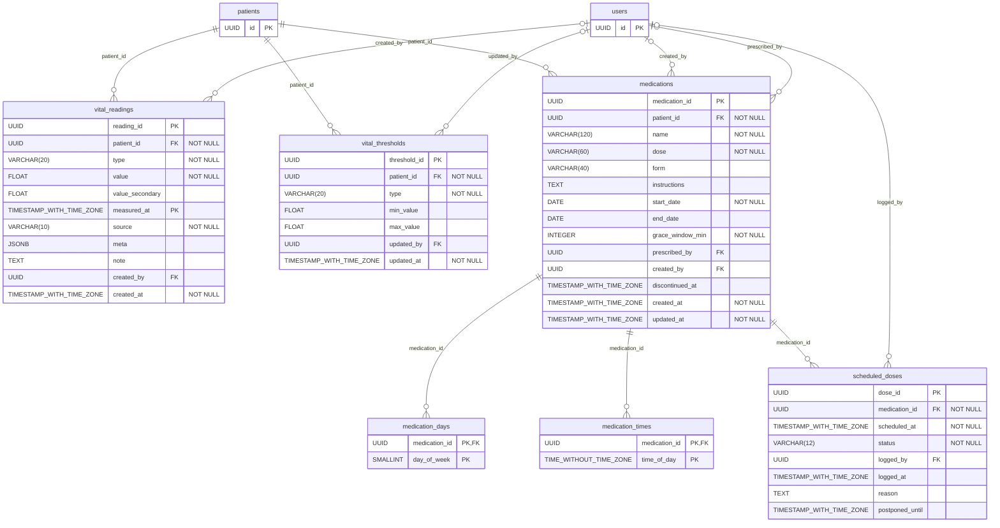
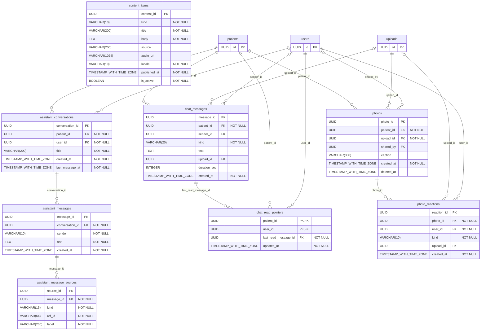

# Modelo de datos AgeCare

47 tablas en PostgreSQL 16 (Azure Database for PostgreSQL Flexible Server). Generado desde `app/models` con `python scripts/export_model.py`.

## Cuentas y acceso

#### `users`

| Columna | Tipo | Clave | Nulo | Referencia |
|---|---|---|---|---|
| user_id | UUID | PK | No |  |
| email | VARCHAR(254) | UK | No |  |
| password_hash | VARCHAR(255) |  | No |  |
| full_name | VARCHAR(120) |  | No |  |
| phone | VARCHAR(20) |  | Sí |  |
| avatar_url | VARCHAR(1024) |  | Sí |  |
| locale | VARCHAR(10) |  | No |  |
| failed_login_count | INTEGER |  | No |  |
| locked_until | TIMESTAMP_WITH_TIME_ZONE |  | Sí |  |
| created_at | TIMESTAMP_WITH_TIME_ZONE |  | No |  |
| updated_at | TIMESTAMP_WITH_TIME_ZONE |  | No |  |

#### `user_preferences`

| Columna | Tipo | Clave | Nulo | Referencia |
|---|---|---|---|---|
| user_id | UUID | PK FK | No | users.user_id |
| alerts_push | BOOLEAN |  | No |  |
| alerts_email | BOOLEAN |  | No |  |
| medication_reminders | BOOLEAN |  | No |  |
| chat_push | BOOLEAN |  | No |  |
| digest_daily | BOOLEAN |  | No |  |

#### `refresh_tokens`

| Columna | Tipo | Clave | Nulo | Referencia |
|---|---|---|---|---|
| refresh_token_id | UUID | PK | No |  |
| user_id | UUID | FK | No | users.user_id |
| token_hash | VARCHAR(64) | UK | No |  |
| expires_at | TIMESTAMP_WITH_TIME_ZONE |  | No |  |
| revoked_at | TIMESTAMP_WITH_TIME_ZONE |  | Sí |  |
| created_at | TIMESTAMP_WITH_TIME_ZONE |  | No |  |

#### `password_reset_tokens`

| Columna | Tipo | Clave | Nulo | Referencia |
|---|---|---|---|---|
| reset_token_id | UUID | PK | No |  |
| user_id | UUID | FK | No | users.user_id |
| token_hash | VARCHAR(64) | UK | No |  |
| expires_at | TIMESTAMP_WITH_TIME_ZONE |  | No |  |
| used_at | TIMESTAMP_WITH_TIME_ZONE |  | Sí |  |

#### `push_devices`

| Columna | Tipo | Clave | Nulo | Referencia |
|---|---|---|---|---|
| device_id | UUID | PK | No |  |
| user_id | UUID | FK | No | users.user_id |
| push_token | VARCHAR(4096) | UK | No |  |
| platform | VARCHAR(10) |  | No |  |
| app_version | VARCHAR(30) |  | Sí |  |
| is_active | BOOLEAN |  | No |  |
| created_at | TIMESTAMP_WITH_TIME_ZONE |  | No |  |
| updated_at | TIMESTAMP_WITH_TIME_ZONE |  | No |  |

#### `notification_settings`

| Columna | Tipo | Clave | Nulo | Referencia |
|---|---|---|---|---|
| notification_setting_id | UUID | PK | No |  |
| user_id | UUID | FK | No | users.user_id |
| alert_type | VARCHAR(30) |  | No |  |
| push_enabled | BOOLEAN |  | No |  |

Únicas compuestas: (user_id, alert_type)

#### `access_logs`

| Columna | Tipo | Clave | Nulo | Referencia |
|---|---|---|---|---|
| access_log_id | UUID | PK | No |  |
| user_id | UUID | FK | No | users.user_id |
| patient_id | UUID | FK | No | patients.patient_id |
| method | VARCHAR(10) |  | No |  |
| path | VARCHAR(500) |  | No |  |
| created_at | TIMESTAMP_WITH_TIME_ZONE |  | No |  |

## Pacientes y círculo de cuidado

#### `patients`

| Columna | Tipo | Clave | Nulo | Referencia |
|---|---|---|---|---|
| patient_id | UUID | PK | No |  |
| full_name | VARCHAR(120) |  | No |  |
| birth_date | DATE |  | No |  |
| sex | VARCHAR(10) |  | Sí |  |
| photo_url | VARCHAR(1024) |  | Sí |  |
| notes | TEXT |  | Sí |  |
| timezone | VARCHAR(64) |  | No |  |
| deleted_at | TIMESTAMP_WITH_TIME_ZONE |  | Sí |  |
| created_at | TIMESTAMP_WITH_TIME_ZONE |  | No |  |
| updated_at | TIMESTAMP_WITH_TIME_ZONE |  | No |  |

#### `patient_conditions`

| Columna | Tipo | Clave | Nulo | Referencia |
|---|---|---|---|---|
| condition_id | UUID | PK | No |  |
| patient_id | UUID | FK | No | patients.patient_id |
| name | VARCHAR(120) |  | No |  |

Únicas compuestas: (patient_id, name)

#### `patient_members`

| Columna | Tipo | Clave | Nulo | Referencia |
|---|---|---|---|---|
| member_id | UUID | PK | No |  |
| patient_id | UUID | FK | No | patients.patient_id |
| user_id | UUID | FK | No | users.user_id |
| role | VARCHAR(20) |  | No |  |
| is_owner | BOOLEAN |  | No |  |
| joined_at | TIMESTAMP_WITH_TIME_ZONE |  | No |  |

Únicas compuestas: (patient_id, user_id)

#### `invitations`

| Columna | Tipo | Clave | Nulo | Referencia |
|---|---|---|---|---|
| invitation_id | UUID | PK | No |  |
| patient_id | UUID | FK | No | patients.patient_id |
| email | VARCHAR(254) |  | Sí |  |
| role | VARCHAR(20) |  | No |  |
| token_hash | VARCHAR(64) | UK | No |  |
| code | VARCHAR(6) |  | No |  |
| expires_at | TIMESTAMP_WITH_TIME_ZONE |  | No |  |
| created_by | UUID | FK | No | users.user_id |
| accepted_by | UUID | FK | Sí | users.user_id |
| accepted_at | TIMESTAMP_WITH_TIME_ZONE |  | Sí |  |
| created_at | TIMESTAMP_WITH_TIME_ZONE |  | No |  |

#### `wearables`

| Columna | Tipo | Clave | Nulo | Referencia |
|---|---|---|---|---|
| wearable_id | UUID | PK | No |  |
| patient_id | UUID | FK | No | patients.patient_id |
| serial_number | VARCHAR(100) | UK | No |  |
| model | VARCHAR(100) |  | No |  |
| battery_pct | INTEGER |  | Sí |  |
| last_sync_at | TIMESTAMP_WITH_TIME_ZONE |  | Sí |  |
| is_active | BOOLEAN |  | No |  |
| linked_at | TIMESTAMP_WITH_TIME_ZONE |  | No |  |

## Vitals y medicamentos

#### `vital_readings`

| Columna | Tipo | Clave | Nulo | Referencia |
|---|---|---|---|---|
| reading_id | UUID | PK | No |  |
| patient_id | UUID | FK | No | patients.patient_id |
| type | VARCHAR(20) |  | No |  |
| value | FLOAT |  | No |  |
| value_secondary | FLOAT |  | Sí |  |
| measured_at | TIMESTAMP_WITH_TIME_ZONE | PK | No |  |
| source | VARCHAR(10) |  | No |  |
| meta | JSONB |  | Sí |  |
| note | TEXT |  | Sí |  |
| created_by | UUID | FK | Sí | users.user_id |
| created_at | TIMESTAMP_WITH_TIME_ZONE |  | No |  |

Únicas compuestas: (patient_id, type, measured_at, source)

#### `vital_thresholds`

| Columna | Tipo | Clave | Nulo | Referencia |
|---|---|---|---|---|
| threshold_id | UUID | PK | No |  |
| patient_id | UUID | FK | No | patients.patient_id |
| type | VARCHAR(20) |  | No |  |
| min_value | FLOAT |  | Sí |  |
| max_value | FLOAT |  | Sí |  |
| updated_by | UUID | FK | Sí | users.user_id |
| updated_at | TIMESTAMP_WITH_TIME_ZONE |  | No |  |

Únicas compuestas: (patient_id, type)

#### `medications`

| Columna | Tipo | Clave | Nulo | Referencia |
|---|---|---|---|---|
| medication_id | UUID | PK | No |  |
| patient_id | UUID | FK | No | patients.patient_id |
| name | VARCHAR(120) |  | No |  |
| dose | VARCHAR(60) |  | No |  |
| form | VARCHAR(40) |  | Sí |  |
| instructions | TEXT |  | Sí |  |
| start_date | DATE |  | No |  |
| end_date | DATE |  | Sí |  |
| grace_window_min | INTEGER |  | No |  |
| prescribed_by | UUID | FK | Sí | users.user_id |
| created_by | UUID | FK | Sí | users.user_id |
| discontinued_at | TIMESTAMP_WITH_TIME_ZONE |  | Sí |  |
| created_at | TIMESTAMP_WITH_TIME_ZONE |  | No |  |
| updated_at | TIMESTAMP_WITH_TIME_ZONE |  | No |  |

#### `medication_times`

| Columna | Tipo | Clave | Nulo | Referencia |
|---|---|---|---|---|
| medication_id | UUID | PK FK | No | medications.medication_id |
| time_of_day | TIME_WITHOUT_TIME_ZONE | PK | No |  |

#### `medication_days`

| Columna | Tipo | Clave | Nulo | Referencia |
|---|---|---|---|---|
| medication_id | UUID | PK FK | No | medications.medication_id |
| day_of_week | SMALLINT | PK | No |  |

#### `scheduled_doses`

| Columna | Tipo | Clave | Nulo | Referencia |
|---|---|---|---|---|
| dose_id | UUID | PK | No |  |
| medication_id | UUID | FK | No | medications.medication_id |
| scheduled_at | TIMESTAMP_WITH_TIME_ZONE |  | No |  |
| status | VARCHAR(12) |  | No |  |
| logged_by | UUID | FK | Sí | users.user_id |
| logged_at | TIMESTAMP_WITH_TIME_ZONE |  | Sí |  |
| reason | TEXT |  | Sí |  |
| postponed_until | TIMESTAMP_WITH_TIME_ZONE |  | Sí |  |

Únicas compuestas: (medication_id, scheduled_at)

## Bitácora, archivos y alertas

```mermaid
erDiagram
    observations {
        UUID observation_id PK
        UUID patient_id FK "NOT NULL"
        UUID author_id FK
        VARCHAR(20) category "NOT NULL"
        TEXT text "NOT NULL"
        UUID photo_upload_id FK
        TIMESTAMP_WITH_TIME_ZONE created_at "NOT NULL"
        TIMESTAMP_WITH_TIME_ZONE deleted_at
    }
    incidents {
        UUID incident_id PK
        UUID patient_id FK "NOT NULL"
        UUID author_id FK
        VARCHAR(20) type "NOT NULL"
        VARCHAR(10) severity "NOT NULL"
        TIMESTAMP_WITH_TIME_ZONE occurred_at "NOT NULL"
        TEXT description "NOT NULL"
        UUID photo_upload_id FK
        UUID alert_id FK
        TIMESTAMP_WITH_TIME_ZONE created_at "NOT NULL"
    }
    handover_notes {
        UUID note_id PK
        UUID patient_id FK "NOT NULL"
        UUID author_id FK
        TEXT text "NOT NULL"
        TIMESTAMP_WITH_TIME_ZONE created_at "NOT NULL"
    }
    elder_checkins {
        UUID checkin_id PK
        UUID patient_id FK "NOT NULL"
        UUID user_id FK
        VARCHAR(10) feeling "NOT NULL"
        DATE checkin_date "NOT NULL"
        TIMESTAMP_WITH_TIME_ZONE created_at "NOT NULL"
    }
    uploads {
        UUID upload_id PK
        UUID user_id FK "NOT NULL"
        VARCHAR(20) purpose "NOT NULL"
        VARCHAR(255) file_name "NOT NULL"
        VARCHAR(500) blob_path UK "NOT NULL"
        VARCHAR(100) content_type "NOT NULL"
        BIGINT size_bytes "NOT NULL"
        VARCHAR(10) status "NOT NULL"
        TIMESTAMP_WITH_TIME_ZONE created_at "NOT NULL"
    }
    documents {
        UUID document_id PK
        UUID patient_id FK "NOT NULL"
        UUID upload_id FK "NOT NULL"
        VARCHAR(150) title "NOT NULL"
        VARCHAR(20) category "NOT NULL"
        DATE doc_date
        UUID uploaded_by FK
        TIMESTAMP_WITH_TIME_ZONE created_at "NOT NULL"
        TIMESTAMP_WITH_TIME_ZONE deleted_at
    }
    alerts {
        UUID alert_id PK
        UUID patient_id FK "NOT NULL"
        VARCHAR(30) type "NOT NULL"
        VARCHAR(10) severity "NOT NULL"
        VARCHAR(200) title "NOT NULL"
        TEXT detail "NOT NULL"
        JSONB payload "NOT NULL"
        VARCHAR(15) status "NOT NULL"
        VARCHAR(200) dedupe_key UK
        UUID acknowledged_by FK
        TIMESTAMP_WITH_TIME_ZONE acknowledged_at
        UUID resolved_by FK
        TIMESTAMP_WITH_TIME_ZONE resolved_at
        TEXT resolution_note
        TIMESTAMP_WITH_TIME_ZONE created_at "NOT NULL"
    }
    sos_events {
        UUID sos_event_id PK
        UUID patient_id FK "NOT NULL"
        UUID triggered_by FK
        TEXT note
        FLOAT lat
        FLOAT lng
        UUID alert_id FK,UK "NOT NULL"
        TIMESTAMP_WITH_TIME_ZONE created_at "NOT NULL"
    }
    patients {
        UUID id PK
    }
    users {
        UUID id PK
    }
    alerts |o--o{ incidents : "alert_id"
    alerts ||--o{ sos_events : "alert_id"
    patients ||--o{ alerts : "patient_id"
    patients ||--o{ documents : "patient_id"
    patients ||--o{ elder_checkins : "patient_id"
    patients ||--o{ handover_notes : "patient_id"
    patients ||--o{ incidents : "patient_id"
    patients ||--o{ observations : "patient_id"
    patients ||--o{ sos_events : "patient_id"
    uploads |o--o{ incidents : "photo_upload_id"
    uploads |o--o{ observations : "photo_upload_id"
    uploads ||--o{ documents : "upload_id"
    users |o--o{ alerts : "acknowledged_by"
    users |o--o{ alerts : "resolved_by"
    users |o--o{ documents : "uploaded_by"
    users |o--o{ elder_checkins : "user_id"
    users |o--o{ handover_notes : "author_id"
    users |o--o{ incidents : "author_id"
    users |o--o{ observations : "author_id"
    users |o--o{ sos_events : "triggered_by"
    users ||--o{ uploads : "user_id"
```

#### `observations`

| Columna | Tipo | Clave | Nulo | Referencia |
|---|---|---|---|---|
| observation_id | UUID | PK | No |  |
| patient_id | UUID | FK | No | patients.patient_id |
| author_id | UUID | FK | Sí | users.user_id |
| category | VARCHAR(20) |  | No |  |
| text | TEXT |  | No |  |
| photo_upload_id | UUID | FK | Sí | uploads.upload_id |
| created_at | TIMESTAMP_WITH_TIME_ZONE |  | No |  |
| deleted_at | TIMESTAMP_WITH_TIME_ZONE |  | Sí |  |

#### `incidents`

| Columna | Tipo | Clave | Nulo | Referencia |
|---|---|---|---|---|
| incident_id | UUID | PK | No |  |
| patient_id | UUID | FK | No | patients.patient_id |
| author_id | UUID | FK | Sí | users.user_id |
| type | VARCHAR(20) |  | No |  |
| severity | VARCHAR(10) |  | No |  |
| occurred_at | TIMESTAMP_WITH_TIME_ZONE |  | No |  |
| description | TEXT |  | No |  |
| photo_upload_id | UUID | FK | Sí | uploads.upload_id |
| alert_id | UUID | FK | Sí | alerts.alert_id |
| created_at | TIMESTAMP_WITH_TIME_ZONE |  | No |  |

#### `handover_notes`

| Columna | Tipo | Clave | Nulo | Referencia |
|---|---|---|---|---|
| note_id | UUID | PK | No |  |
| patient_id | UUID | FK | No | patients.patient_id |
| author_id | UUID | FK | Sí | users.user_id |
| text | TEXT |  | No |  |
| created_at | TIMESTAMP_WITH_TIME_ZONE |  | No |  |

#### `elder_checkins`

| Columna | Tipo | Clave | Nulo | Referencia |
|---|---|---|---|---|
| checkin_id | UUID | PK | No |  |
| patient_id | UUID | FK | No | patients.patient_id |
| user_id | UUID | FK | Sí | users.user_id |
| feeling | VARCHAR(10) |  | No |  |
| checkin_date | DATE |  | No |  |
| created_at | TIMESTAMP_WITH_TIME_ZONE |  | No |  |

Únicas compuestas: (patient_id, checkin_date)

#### `uploads`

| Columna | Tipo | Clave | Nulo | Referencia |
|---|---|---|---|---|
| upload_id | UUID | PK | No |  |
| user_id | UUID | FK | No | users.user_id |
| purpose | VARCHAR(20) |  | No |  |
| file_name | VARCHAR(255) |  | No |  |
| blob_path | VARCHAR(500) | UK | No |  |
| content_type | VARCHAR(100) |  | No |  |
| size_bytes | BIGINT |  | No |  |
| status | VARCHAR(10) |  | No |  |
| created_at | TIMESTAMP_WITH_TIME_ZONE |  | No |  |

#### `documents`

| Columna | Tipo | Clave | Nulo | Referencia |
|---|---|---|---|---|
| document_id | UUID | PK | No |  |
| patient_id | UUID | FK | No | patients.patient_id |
| upload_id | UUID | FK | No | uploads.upload_id |
| title | VARCHAR(150) |  | No |  |
| category | VARCHAR(20) |  | No |  |
| doc_date | DATE |  | Sí |  |
| uploaded_by | UUID | FK | Sí | users.user_id |
| created_at | TIMESTAMP_WITH_TIME_ZONE |  | No |  |
| deleted_at | TIMESTAMP_WITH_TIME_ZONE |  | Sí |  |

#### `alerts`

| Columna | Tipo | Clave | Nulo | Referencia |
|---|---|---|---|---|
| alert_id | UUID | PK | No |  |
| patient_id | UUID | FK | No | patients.patient_id |
| type | VARCHAR(30) |  | No |  |
| severity | VARCHAR(10) |  | No |  |
| title | VARCHAR(200) |  | No |  |
| detail | TEXT |  | No |  |
| payload | JSONB |  | No |  |
| status | VARCHAR(15) |  | No |  |
| dedupe_key | VARCHAR(200) | UK | Sí |  |
| acknowledged_by | UUID | FK | Sí | users.user_id |
| acknowledged_at | TIMESTAMP_WITH_TIME_ZONE |  | Sí |  |
| resolved_by | UUID | FK | Sí | users.user_id |
| resolved_at | TIMESTAMP_WITH_TIME_ZONE |  | Sí |  |
| resolution_note | TEXT |  | Sí |  |
| created_at | TIMESTAMP_WITH_TIME_ZONE |  | No |  |

#### `sos_events`

| Columna | Tipo | Clave | Nulo | Referencia |
|---|---|---|---|---|
| sos_event_id | UUID | PK | No |  |
| patient_id | UUID | FK | No | patients.patient_id |
| triggered_by | UUID | FK | Sí | users.user_id |
| note | TEXT |  | Sí |  |
| lat | FLOAT |  | Sí |  |
| lng | FLOAT |  | Sí |  |
| alert_id | UUID | FK UK | No | alerts.alert_id |
| created_at | TIMESTAMP_WITH_TIME_ZONE |  | No |  |

## Comunicación y adulto mayor

#### `assistant_conversations`

| Columna | Tipo | Clave | Nulo | Referencia |
|---|---|---|---|---|
| conversation_id | UUID | PK | No |  |
| patient_id | UUID | FK | No | patients.patient_id |
| user_id | UUID | FK | No | users.user_id |
| title | VARCHAR(200) |  | No |  |
| created_at | TIMESTAMP_WITH_TIME_ZONE |  | No |  |
| last_message_at | TIMESTAMP_WITH_TIME_ZONE |  | No |  |

#### `assistant_messages`

| Columna | Tipo | Clave | Nulo | Referencia |
|---|---|---|---|---|
| message_id | UUID | PK | No |  |
| conversation_id | UUID | FK | No | assistant_conversations.conversation_id |
| sender | VARCHAR(10) |  | No |  |
| text | TEXT |  | No |  |
| created_at | TIMESTAMP_WITH_TIME_ZONE |  | No |  |

#### `assistant_message_sources`

| Columna | Tipo | Clave | Nulo | Referencia |
|---|---|---|---|---|
| source_id | UUID | PK | No |  |
| message_id | UUID | FK | No | assistant_messages.message_id |
| kind | VARCHAR(15) |  | No |  |
| ref_id | VARCHAR(64) |  | No |  |
| label | VARCHAR(200) |  | No |  |

#### `chat_messages`

| Columna | Tipo | Clave | Nulo | Referencia |
|---|---|---|---|---|
| message_id | UUID | PK | No |  |
| patient_id | UUID | FK | No | patients.patient_id |
| sender_id | UUID | FK | Sí | users.user_id |
| kind | VARCHAR(20) |  | No |  |
| text | TEXT |  | Sí |  |
| upload_id | UUID | FK | Sí | uploads.upload_id |
| duration_sec | INTEGER |  | Sí |  |
| created_at | TIMESTAMP_WITH_TIME_ZONE |  | No |  |

#### `chat_read_pointers`

| Columna | Tipo | Clave | Nulo | Referencia |
|---|---|---|---|---|
| patient_id | UUID | PK FK | No | patients.patient_id |
| user_id | UUID | PK FK | No | users.user_id |
| last_read_message_id | UUID | FK | No | chat_messages.message_id |
| updated_at | TIMESTAMP_WITH_TIME_ZONE |  | No |  |

#### `photos`

| Columna | Tipo | Clave | Nulo | Referencia |
|---|---|---|---|---|
| photo_id | UUID | PK | No |  |
| patient_id | UUID | FK | No | patients.patient_id |
| upload_id | UUID | FK | No | uploads.upload_id |
| shared_by | UUID | FK | Sí | users.user_id |
| caption | VARCHAR(300) |  | Sí |  |
| created_at | TIMESTAMP_WITH_TIME_ZONE |  | No |  |
| deleted_at | TIMESTAMP_WITH_TIME_ZONE |  | Sí |  |

#### `photo_reactions`

| Columna | Tipo | Clave | Nulo | Referencia |
|---|---|---|---|---|
| reaction_id | UUID | PK | No |  |
| photo_id | UUID | FK | No | photos.photo_id |
| user_id | UUID | FK | No | users.user_id |
| kind | VARCHAR(10) |  | No |  |
| upload_id | UUID | FK | Sí | uploads.upload_id |
| created_at | TIMESTAMP_WITH_TIME_ZONE |  | No |  |

#### `content_items`

| Columna | Tipo | Clave | Nulo | Referencia |
|---|---|---|---|---|
| content_id | UUID | PK | No |  |
| kind | VARCHAR(10) |  | No |  |
| title | VARCHAR(200) |  | No |  |
| body | TEXT |  | No |  |
| source | VARCHAR(200) |  | Sí |  |
| audio_url | VARCHAR(1024) |  | Sí |  |
| locale | VARCHAR(10) |  | No |  |
| published_at | TIMESTAMP_WITH_TIME_ZONE |  | No |  |
| is_active | BOOLEAN |  | No |  |

## Cuidadora y marketplace

```mermaid
erDiagram
    care_tasks {
        UUID task_id PK
        UUID patient_id FK "NOT NULL"
        VARCHAR(15) category "NOT NULL"
        VARCHAR(150) title "NOT NULL"
        DATE start_date "NOT NULL"
        TIME_WITHOUT_TIME_ZONE time_of_day
        VARCHAR(10) recurrence "NOT NULL"
        UUID created_by FK
        TIMESTAMP_WITH_TIME_ZONE created_at "NOT NULL"
        TIMESTAMP_WITH_TIME_ZONE archived_at
    }
    care_task_completions {
        UUID task_id PK,FK
        DATE task_date PK
        VARCHAR(10) status "NOT NULL"
        TEXT note
        UUID done_by FK
        TIMESTAMP_WITH_TIME_ZONE done_at
    }
    caregiver_profiles {
        UUID profile_id PK
        UUID user_id FK,UK "NOT NULL"
        VARCHAR(150) headline
        TEXT bio
        INTEGER years_experience
        VARCHAR(10) contact_channel "NOT NULL"
        VARCHAR(254) contact_value
        BOOLEAN is_listed "NOT NULL"
        BOOLEAN is_featured "NOT NULL"
        TIMESTAMP_WITH_TIME_ZONE created_at "NOT NULL"
        TIMESTAMP_WITH_TIME_ZONE updated_at "NOT NULL"
    }
    caregiver_specialties {
        UUID profile_id PK,FK
        VARCHAR(80) name PK
    }
    caregiver_languages {
        UUID profile_id PK,FK
        VARCHAR(40) name PK
    }
    caregiver_zones {
        UUID profile_id PK,FK
        VARCHAR(80) name PK
    }
    caregiver_certifications {
        UUID certification_id PK
        UUID profile_id FK "NOT NULL"
        VARCHAR(150) name "NOT NULL"
        VARCHAR(150) issuer
        SMALLINT year
        UUID document_id FK
    }
    caregiver_subscriptions {
        UUID subscription_id PK
        UUID user_id FK,UK "NOT NULL"
        VARCHAR(10) plan "NOT NULL"
        VARCHAR(15) store
        VARCHAR(1024) purchase_token
        TIMESTAMP_WITH_TIME_ZONE valid_until
        TIMESTAMP_WITH_TIME_ZONE created_at "NOT NULL"
    }
    job_offers {
        UUID job_id PK
        VARCHAR(150) title "NOT NULL"
        TEXT description "NOT NULL"
        VARCHAR(100) zone "NOT NULL"
        VARCHAR(150) schedule "NOT NULL"
        VARCHAR(100) pay_range
        VARCHAR(254) contact_info "NOT NULL"
        BOOLEAN is_active "NOT NULL"
        TIMESTAMP_WITH_TIME_ZONE published_at "NOT NULL"
    }
    marketplace_products {
        UUID product_id PK
        VARCHAR(150) name "NOT NULL"
        VARCHAR(20) category "NOT NULL"
        TEXT description "NOT NULL"
        VARCHAR(60) price_range "NOT NULL"
        VARCHAR(1024) external_url
        VARCHAR(254) contact_info
        BOOLEAN is_active "NOT NULL"
        TIMESTAMP_WITH_TIME_ZONE created_at "NOT NULL"
    }
    product_photos {
        UUID product_id PK,FK
        SMALLINT position PK
        VARCHAR(1024) url "NOT NULL"
    }
    caregiver_reviews {
        UUID review_id PK
        UUID profile_id FK "NOT NULL"
        UUID author_id FK "NOT NULL"
        INTEGER rating "NOT NULL"
        TEXT comment
        TIMESTAMP_WITH_TIME_ZONE created_at "NOT NULL"
    }
    contact_requests {
        UUID contact_request_id PK
        UUID profile_id FK "NOT NULL"
        UUID family_user_id FK "NOT NULL"
        TEXT message
        TIMESTAMP_WITH_TIME_ZONE created_at "NOT NULL"
    }
    documents {
        UUID id PK
    }
    patients {
        UUID id PK
    }
    users {
        UUID id PK
    }
    care_tasks ||--o{ care_task_completions : "task_id"
    caregiver_profiles ||--o{ caregiver_certifications : "profile_id"
    caregiver_profiles ||--o{ caregiver_languages : "profile_id"
    caregiver_profiles ||--o{ caregiver_reviews : "profile_id"
    caregiver_profiles ||--o{ caregiver_specialties : "profile_id"
    caregiver_profiles ||--o{ caregiver_zones : "profile_id"
    caregiver_profiles ||--o{ contact_requests : "profile_id"
    documents |o--o{ caregiver_certifications : "document_id"
    marketplace_products ||--o{ product_photos : "product_id"
    patients ||--o{ care_tasks : "patient_id"
    users |o--o{ care_task_completions : "done_by"
    users |o--o{ care_tasks : "created_by"
    users ||--o{ caregiver_profiles : "user_id"
    users ||--o{ caregiver_reviews : "author_id"
    users ||--o{ caregiver_subscriptions : "user_id"
    users ||--o{ contact_requests : "family_user_id"
```

#### `care_tasks`

| Columna | Tipo | Clave | Nulo | Referencia |
|---|---|---|---|---|
| task_id | UUID | PK | No |  |
| patient_id | UUID | FK | No | patients.patient_id |
| category | VARCHAR(15) |  | No |  |
| title | VARCHAR(150) |  | No |  |
| start_date | DATE |  | No |  |
| time_of_day | TIME_WITHOUT_TIME_ZONE |  | Sí |  |
| recurrence | VARCHAR(10) |  | No |  |
| created_by | UUID | FK | Sí | users.user_id |
| created_at | TIMESTAMP_WITH_TIME_ZONE |  | No |  |
| archived_at | TIMESTAMP_WITH_TIME_ZONE |  | Sí |  |

#### `care_task_completions`

| Columna | Tipo | Clave | Nulo | Referencia |
|---|---|---|---|---|
| task_id | UUID | PK FK | No | care_tasks.task_id |
| task_date | DATE | PK | No |  |
| status | VARCHAR(10) |  | No |  |
| note | TEXT |  | Sí |  |
| done_by | UUID | FK | Sí | users.user_id |
| done_at | TIMESTAMP_WITH_TIME_ZONE |  | Sí |  |

#### `caregiver_profiles`

| Columna | Tipo | Clave | Nulo | Referencia |
|---|---|---|---|---|
| profile_id | UUID | PK | No |  |
| user_id | UUID | FK UK | No | users.user_id |
| headline | VARCHAR(150) |  | Sí |  |
| bio | TEXT |  | Sí |  |
| years_experience | INTEGER |  | Sí |  |
| contact_channel | VARCHAR(10) |  | No |  |
| contact_value | VARCHAR(254) |  | Sí |  |
| is_listed | BOOLEAN |  | No |  |
| is_featured | BOOLEAN |  | No |  |
| created_at | TIMESTAMP_WITH_TIME_ZONE |  | No |  |
| updated_at | TIMESTAMP_WITH_TIME_ZONE |  | No |  |

#### `caregiver_specialties`

| Columna | Tipo | Clave | Nulo | Referencia |
|---|---|---|---|---|
| profile_id | UUID | PK FK | No | caregiver_profiles.profile_id |
| name | VARCHAR(80) | PK | No |  |

#### `caregiver_languages`

| Columna | Tipo | Clave | Nulo | Referencia |
|---|---|---|---|---|
| profile_id | UUID | PK FK | No | caregiver_profiles.profile_id |
| name | VARCHAR(40) | PK | No |  |

#### `caregiver_zones`

| Columna | Tipo | Clave | Nulo | Referencia |
|---|---|---|---|---|
| profile_id | UUID | PK FK | No | caregiver_profiles.profile_id |
| name | VARCHAR(80) | PK | No |  |

#### `caregiver_certifications`

| Columna | Tipo | Clave | Nulo | Referencia |
|---|---|---|---|---|
| certification_id | UUID | PK | No |  |
| profile_id | UUID | FK | No | caregiver_profiles.profile_id |
| name | VARCHAR(150) |  | No |  |
| issuer | VARCHAR(150) |  | Sí |  |
| year | SMALLINT |  | Sí |  |
| document_id | UUID | FK | Sí | documents.document_id |

#### `caregiver_subscriptions`

| Columna | Tipo | Clave | Nulo | Referencia |
|---|---|---|---|---|
| subscription_id | UUID | PK | No |  |
| user_id | UUID | FK UK | No | users.user_id |
| plan | VARCHAR(10) |  | No |  |
| store | VARCHAR(15) |  | Sí |  |
| purchase_token | VARCHAR(1024) |  | Sí |  |
| valid_until | TIMESTAMP_WITH_TIME_ZONE |  | Sí |  |
| created_at | TIMESTAMP_WITH_TIME_ZONE |  | No |  |

#### `job_offers`

| Columna | Tipo | Clave | Nulo | Referencia |
|---|---|---|---|---|
| job_id | UUID | PK | No |  |
| title | VARCHAR(150) |  | No |  |
| description | TEXT |  | No |  |
| zone | VARCHAR(100) |  | No |  |
| schedule | VARCHAR(150) |  | No |  |
| pay_range | VARCHAR(100) |  | Sí |  |
| contact_info | VARCHAR(254) |  | No |  |
| is_active | BOOLEAN |  | No |  |
| published_at | TIMESTAMP_WITH_TIME_ZONE |  | No |  |

#### `marketplace_products`

| Columna | Tipo | Clave | Nulo | Referencia |
|---|---|---|---|---|
| product_id | UUID | PK | No |  |
| name | VARCHAR(150) |  | No |  |
| category | VARCHAR(20) |  | No |  |
| description | TEXT |  | No |  |
| price_range | VARCHAR(60) |  | No |  |
| external_url | VARCHAR(1024) |  | Sí |  |
| contact_info | VARCHAR(254) |  | Sí |  |
| is_active | BOOLEAN |  | No |  |
| created_at | TIMESTAMP_WITH_TIME_ZONE |  | No |  |

#### `product_photos`

| Columna | Tipo | Clave | Nulo | Referencia |
|---|---|---|---|---|
| product_id | UUID | PK FK | No | marketplace_products.product_id |
| position | SMALLINT | PK | No |  |
| url | VARCHAR(1024) |  | No |  |

#### `caregiver_reviews`

| Columna | Tipo | Clave | Nulo | Referencia |
|---|---|---|---|---|
| review_id | UUID | PK | No |  |
| profile_id | UUID | FK | No | caregiver_profiles.profile_id |
| author_id | UUID | FK | No | users.user_id |
| rating | INTEGER |  | No |  |
| comment | TEXT |  | Sí |  |
| created_at | TIMESTAMP_WITH_TIME_ZONE |  | No |  |

Únicas compuestas: (profile_id, author_id)

#### `contact_requests`

| Columna | Tipo | Clave | Nulo | Referencia |
|---|---|---|---|---|
| contact_request_id | UUID | PK | No |  |
| profile_id | UUID | FK | No | caregiver_profiles.profile_id |
| family_user_id | UUID | FK | No | users.user_id |
| message | TEXT |  | Sí |  |
| created_at | TIMESTAMP_WITH_TIME_ZONE |  | No |  |
